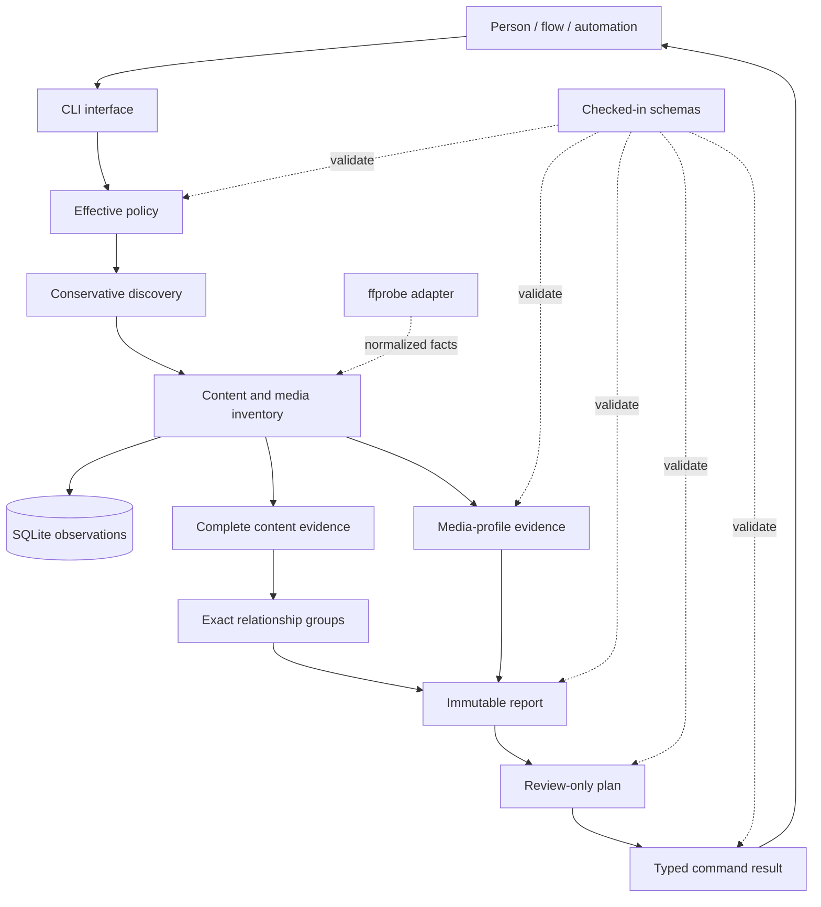

# OptiFlow Architecture

## Local support diagnostics

An explicitly selected support command bypasses media configuration, persistent
state and provider discovery. Its product-owned SDK generates bounded metadata,
uses the existing BLAKE3 owner and guarded file reads, and preserves create-new
output semantics. Health distinguishes unsupported exporters from unknown
measurements. Support output cannot authorize mutation, validate user media or
establish native qualification; it initializes no telemetry or network service.

## MP4 operational progress

Caller-owned synchronous observers receive bounded phase/entry events from the
existing producer and serial-folder owners. Known entry totals are distinct from
indeterminate encoding; no fabricated percent or accepted state is inferred.
Events contain no media, source paths, tool argv, metadata or native captures.
An explicitly selected private no-clobber CLI JSONL sink stays outside source,
work/store/journal namespaces. Event limits and sink failures remain operational
diagnostics and never change domain request/plan/artifact identities or outcome.
Machine stdout retains one final command result. Progress cannot establish
validation, checkpoint reuse, human approval, native qualification or completion.

## Read-only MP4 preflight

The MP4 owner independently observes selected source/tool pins, private output
roots, free-space admission and the explicit local user-manager socket without
starting a process or connecting to a service. It reuses planning/resource
arithmetic and reports each missing prerequisite. Host/space observations are
not reservations, actual confinement, delegation or native qualification. The
existing runtime rechecks all execution prerequisites and actual guard receipts.

## MP4 configuration resolution

The existing configuration owner resolves optional MP4 settings from its current
user/project or explicitly selected TOML source. A distinct selection request
may inherit control and limits; a complete v1 request keeps every value explicit.
An explicitly selected CLI settings document has final precedence. No lossy
control, provider, source, path, permission or resource policy is guessed.
Resolution exposes effective values/provenance and yields the same closed v1
producer request, whose full effective policy remains bound into existing plans.
Pure descriptions/readback bypass configuration and mutable state. Configuration
resolution grants no execution, human approval, mutation or release authority.

## MP4 CLI and serial folder continuation

The explicit MP4 command family delegates to the same public inspection,
planning, production and pinned readback owners before mutable application
state. Its folder lane reuses bounded descriptor discovery with a distinct MP4
classifier, frozen inventory and exact tool baseline. Immutable per-entry
start/result records and explicit bounded continuation permit only never-started
work after reconciliation. Uncertain/failed starts, unknown journal/store members,
changed source/tools or unaccounted artifacts block replay/adoption. Per-file
production remains the existing MP4 owner; originals, native qualification,
human review and all mutation/disposal authority remain separate.

The explicit folder policy removes only the exact generated scratch candidate
after durable owner result and committed-artifact reinspection. Retained audit
files, original inputs, accepted private artifacts and uncertain/failed scratch
remain. Missing cleanup receipts block continuation; cleanup is never inferred
from absence. This limits duplicate candidate accumulation in serial runs.

## Independently validated MP4 artifacts

An independent container/payload/clock comparison and complete selected native
decode precede private artifact commitment. AAC packets/configuration, supported
metadata and exact presentation/edit clocks must remain equal; changed video
pixels remain explicitly lossy and need human quality review. Actual byte caps
and strict reduction govern publication. Versioned private markers reuse existing
no-follow, fsync and no-replace primitives. Digest-pinned readback checks current
candidate structure and retained evidence without refreshing original/native or
release qualification. No replacement/disposal or public upload follows.

## Guarded MP4 encoding

The existing user-manager/cgroup/tmpfs guard admits a separately versioned MP4
resource policy and longer explicit deadline. Legacy launch limits stay intact.
A closed internal worker keeps both encoder passes and bounded statistics in
one private scratch namespace, verifies input/tool pins and compiles fixed argv.
Framed worker reports, native resource receipts and exact returned byte hashes
remain evidence rather than acceptance. Unaccepted candidates are retained only
in private attempts until independent validation/publication. No source mutation,
shell, generic process engine, implicit installation or native qualification is
introduced; unsupported guards/hosts fail closed.

## Explicit MP4 quality and size planning

Read-only delivery planning binds source/container identity, selected provider
and launcher bytes, explicit quality or byte-budget policy and complete resource
admission. Target-size arithmetic reserves the observed copied-audio payload
and explicit mux allowance before allocating a two-pass video bitrate. Estimated
rate is intent, never a guaranteed output size or musical/visual approval. Fixed
argv preserves clocks, geometry and audio-copy intent without shell evaluation,
trimming or automatic lossy retries. Native execution remains a separate action.

## Explicit MP4 delivery candidates

A separate MP4 delivery boundary admits a bounded H.264/AAC, SDR, progressive,
constant-frame-rate subset. Descriptor-bound range reads and a host-owned ISO
sample-table observer retain source bytes, presentation clocks, audio payload
identity and supported metadata independently of provider claims. The larger
input ceiling is opt-in; historical observation and FFV1 v1/v2 contracts retain
their limits. Codec declarations do not establish native decode, perceptual
quality, qualification or replacement authority. Existing bounded supervision
and private artifact primitives remain the owners of later execution/publication.

## Tool-free video folder preview

The existing bounded discovery walker also serves an explicit read-only preview
request with selected v1/v2 profile limits. Preview requires no FFmpeg, sandbox,
work/store/journal namespaces or production request. Its separate fingerprint and
inventory schema cannot be adopted by run/resume. A pure profile catalog exposes
the same internal limits used by production; preview does not add codecs or
qualify native execution, reclaim space, replace files or grant replay authority.

## Independent release cohort and interface inventory

The public `release_contract` SDK describes compiled interfaces without observing
state, providers or native capability. Thin CLI delivery bypasses normal mutable
configuration/state setup for this descriptor. Offline distribution scripting
retains exact existing qualified archives, adds descriptor sidecars and a bounded
unsigned target/profile cohort index, and assembles independently versioned owner
reports. It does not repackage qualified bytes or grant mutation/runtime authority.
Existing native, transaction, PNG, release and signing owners remain authoritative.

## Purpose and Scope

This document defines how OptiFlow's logical systems are structurally organized,
how dependencies may cross boundaries, and how the product participates in the
larger Ego Hygiene platform. [`SYSTEM.md`](SYSTEM.md) owns the logical system
inventory; this document owns structural rules.

The current execution boundary converts immutable filesystem observations into
evidence-backed relationships, media-profile review opportunities, reports,
and review-only plans. Mutation, transactional
replacement, validation, quarantine, and recovery are future structural units
and must not be simulated inside the read-only pipeline.

## Structural Units or Layers

### Descriptor-bound cross-copy property integration (#111)

A safe borrowed-file backend port binds the existing stronger Mac property
declarations to host-observed object/content windows. Its observations carry
backend identity and explicit unqualified status; declared properties alone
cannot become native evidence. Copy-property installation rechecks both held
subjects and independently rereads the destination. It never removes a source.
The default backend remains unavailable until a reviewed safe descriptor ACL
dependency and native qualification are supplied. Historical Linux and
same-volume Mac encodings and production dispatch remain unchanged. Proposed
ADR-0004 records this integration and its remaining dependency gate.

### Explicit broader lossless video profile (#146)

The separate v2 production/candidate/evidence/marker contract selects a bounded
720p, longer-count FFV1/Matroska stream-copy profile. One internal profile value
owns admission, provider pipe bounds, independent container/probe parsing,
complete decode and durable publication/readback limits. V1 entry points and
fingerprint domains retain their tiny subset. The same explicitly selected
Linux resource guard owns provider-subtree/scratch enforcement; payload estimates
do not become full host RSS guarantees. No new codec engine, lossy execution,
folder-default upgrade, replacement or physical-reclamation authority follows.
See proposed ADR-0002 and the v2 profile guide; native qualification remains open.

### Optional evidence explanation (#133)

A bounded domain projection derives normalized record facts from explicitly
pinned report/plan bytes. The existing SDK v1 ReportProvider accepts only this
packet and returns an optional cited advisory contribution. Exact host fact
projection is separate from unverified suggestion meaning; neither establishes
current source eligibility, physical savings or mutation authority. Source
paths/content, credentials and raw provider environments never enter this
packet. A supplied fake candidate exercises the reporting seam without a model
runtime, new router or Flow dependency. See proposed ADR-0003; trusted runtime
handoff and released profile adoption remain later explicit work.

### Interface Layer

Owns CLI syntax, human and machine rendering, stream behavior, and operating
system exit status.

- Modules: `cli`, `render`, the binary entry point.
- Accepts and emits versioned application values.
- Does not derive relationship evidence or infer process outcome from text.

### Application Layer

Coordinates use cases, resolves one typed command outcome, handles cooperative
interruption, and defines artifact-commit boundaries.

- Modules: the `app` dispatcher and its `scan`, `reporting`, and
  `extension_commands` use-case modules; `outcome`; `signals`; and
  `configuration::resolver`.
- Receives explicit ports and fully materialized policy.
- Does not contain adapter parsing or filesystem-specific mutation.

### Domain Layer

Owns canonical concepts, evidence rules, effective policy values, inventory
classification, exact-group derivation, and plan semantics.

- Modules: `domain`, `configuration::policy`, `inventory`, `duplicates`,
  `media_profiles`, `planning`.
- Depends on data and behavior it owns rather than concrete external tools.
- Contains no shell, terminal, GitHub, container, or cloud-provider semantics.

### Evidence and Contract Layer

Owns complete hashing, checked-in machine contracts, runtime validation, and
the stable boundary between domain values and persisted or subprocess-visible
documents.

- Modules: `hashing`, `contracts`; files: `schemas/`.
- Schema identity is independent from the Rust crate version.
- Validation occurs before an artifact is reported as committed.

`png_candidate` separately checks the consistency of proposed PNG candidate
request/provider/host evidence under a closed contract. It performs no IO and
is not connected to application execution or artifact acceptance. Its
`ConsistentForReview` result grants no authority. The separate `png_validation`
library observes actual immutable source/candidate bytes for a documented
static PNG subset, including full decode and direct preservation comparisons.
Its opaque result supplies byte facts only; filesystem stability, provider
execution, resource measurements, candidate generation, and media publication
remain future architecture work. Neither API is connected to the CLI.

The unvalidated development module `execution::property_evidence` separately
reviews bounded Mac cross-copy property declarations under its own schema and
profile. It performs no IO and neither consumes the proposed ACL dependency nor
emits transaction events. The schema/profile and complete ordered properties
bind its fingerprint; structural review never grants observation or mutation
authority. Historical property fingerprints and execution v1–v4 formats retain
their meaning. Native observation and a discriminated persistence envelope must
be integrated after reviewed backend adoption; see the
[property protocol](docs/execution-macos-copy-properties.md).

### Infrastructure Layer

Implements operating-system, SQLite, filesystem, external-adapter, and
artifact-set publication ports.

- Modules: `artifact_set`, `filesystem`, `state`, `adapters::ffprobe`.
- Migrations live in `migrations/` and move forward explicitly.
- External output is treated as untrusted until parsed and normalized.

### Publication Layer

Builds separate static product surfaces from `web/landing/`,
`web/architecture/`, `docs/`, and `schemas/`. It describes the application but
is not part of the CLI runtime.

- Build boundary: `scripts/site/build.sh`.
- Architecture projection: `scripts/site/generate_architecture.py` reads this
  corpus and repository-owned portal configuration without becoming a new
  architecture authority.
- Verification boundary: `scripts/site/verify.py` and strict Zensical build.
- Output: one collision-checked `dist/` tree.

## Runtime and Data Flow



The `v0.1.x` authority boundary ends after plan generation. A future execution
flow begins by loading historical evidence and then creating new current
observations; it never treats the diagram's final plan node as direct write
permission.

## Component Map

| Component | Layer | Responsibility |
| --- | --- | --- |
| `cli` | Interface | Parse commands, output mode, selectors, and traversal overrides |
| `configuration::resolver` | Application | Select, snapshot, merge, validate, and explain configuration |
| `configuration::policy` | Domain | Hold values, provenance, locked invariants, and fingerprints |
| `app` | Application | Resolve configuration once and dispatch typed command use cases |
| `app::scan` | Application | Coordinate discovery, observation, exact evidence, persistence, and atomic scan publication |
| `app::reporting` | Application | Load compatible evidence and coordinate report and review-plan publication |
| `app::extension_commands` | Application | Coordinate explicit extension catalog inspection and typed availability outcomes |
| `outcome` | Application | Resolve diagnostics, coverage, artifacts, and exit semantics |
| `signals` | Application | Capture cooperative interruption without terminating library code |
| `render` | Interface | Enforce stdout/stderr ownership and buffered JSON rendering |
| `discovery` | Application/infrastructure boundary | Traverse explicit inputs under conservative policy |
| `inventory` | Domain | Normalize filesystem and media observations |
| `adapters::ffprobe` | Infrastructure | Bind one exact executable identity, invoke it from the read-only handle, and validate bounded evidence |
| `media_profiles` | Domain | Derive versioned, deterministic review opportunities and honest scoped coverage from accepted observations |
| `extensions` | Application/contract boundary | Validate explicit provider declarations and locks, resolve precedence, register typed embedded roles, and reject unsafe contributions |
| `extensions::process` | Infrastructure | Invoke one absolute, byte-pinned trusted provider with bounded JSON stdio and no inherited environment |
| `hashing` | Evidence | Stream complete BLAKE3-256 hashes with cancellation checkpoints |
| `duplicates` | Domain | Derive exact groups from equal size and complete hash evidence |
| `state` | Infrastructure | Persist lifecycle, observations, groups, and cache in SQLite |
| `planning` | Domain | Create non-mutating actions and future preconditions |
| `artifact_set` | Infrastructure | Stage, seal, publish, inspect, and recover related JSON artifacts |
| `reports` | Interface | Render typed reports and plans for human or JSON output |
| `contracts` | Evidence | Compile and enforce checked-in JSON Schemas at runtime |

## Boundary Rules

1. Configuration is resolved once before domain execution. Domain modules do
   not reopen configuration files or reread environment variables.
2. Source media is opened read-only. No source-write port exists in the current
   runtime.
3. External tools are invoked without a shell, with bounded arguments and
   normalized results.
4. Path observations remain distinct from content identity.
5. Cache reuse is explicit and must acquire missing evidence when a new claim
   requires it.
6. A report is accepted as source evidence only when its artifact set is
   committed, or when its historical contract predates artifact-set markers.
7. A plan is a new immutable projection and declares that it does not mutate
   files.
8. Renderers receive typed outcomes; message text never controls exit status.
9. Infrastructure orchestration consumes released CLI and artifact contracts;
   it does not embed default-branch source.
10. Publication producers build in isolation and reject final-path collisions.
11. Generated architecture projections remain disposable; canonical meaning
    changes only in the root architecture documents or their declared local
    presentation configuration.
12. Extension manifests only declare. Operator locks grant trust, effects,
    precedence, configuration, and fallback for exact provider bytes.
13. Extension results are proposed evidence. They cannot publish artifacts,
    execute plans, mutate source media, or bypass core revalidation,
    authorization, hashing, byte confirmation, provenance, and recovery.
14. Built-in media profiles consume accepted observations only. Missing,
    stale, partial, unavailable, or invalid provider evidence produces no
    opportunity.
15. Provider success is necessary but insufficient: the exact executable
    identity, bounded output, empty error stream, JSON shape, and expected
    semantic observations must all validate.

## Dependency Direction

```text
interface
    |
    v
application -----> evidence/contracts
    |
    v
domain <--------- normalized ports
    ^
    |
infrastructure implementations
```

Higher-level policy and domain language must not depend on GitHub Actions,
Zensical, Docker, Kubernetes, cloud SDKs, SQLite row layouts, or raw `ffprobe`
JSON. Infrastructure implements the boundaries required by application and
domain use cases.

The command coordinator is split by proven scan, report/plan, and extension
use cases. The wider module graph still predates a formal compile-time boundary
linter; new changes should move toward the declared direction without creating
indirection that has no demonstrated boundary value.

## Communication Patterns

- In-process components exchange typed Rust values.
- External adapters exchange bounded subprocess arguments and structured
  output.
- Embedded extensions register role-specific Rust traits; trusted process
  extensions exchange closed, bounded, independently versioned JSON documents.
- Local persistence uses transactional SQLite plus immutable JSON artifacts.
- Media-profile evidence binds profile configuration, evidence policy, native
  path facts, normalized observations, and exact provider identity.
- Automation exchanges `optiflow.command-result.v1` and referenced artifacts.
- `flow` invokes the binary as a subprocess and branches on complete schema
  identifiers and exit codes.
- Future telemetry describes runtime health through a separate observability
  port and does not replace domain artifacts.

## Deployment Topology

### Current standalone topology

```text
optiflow process
├── read-only source paths
├── optional ffprobe child process
├── local SQLite state
└── immutable artifact directory
```

### Reproducible environment topology

Realm may package the same process and its declared adapters in a devcontainer
or OCI image. Source and state enter through explicit mounts. The container
does not receive broader filesystem or network access by default.

### Future scheduled topology

Relay and infrastructure code may run the OCI artifact as a local, CI, cluster,
or cloud batch job. The job remains a contract consumer. Kubernetes, serverless
containers, and provider batch systems are interchangeable scheduling adapters
only where their storage, identity, interruption, and artifact-retention
semantics satisfy OptiFlow requirements.

## Significant Constraints

- SQLite rollback journal and `FULL` synchronization are used rather than
  assuming WAL behavior on arbitrary scanned filesystems.
- Related scan artifacts are validated, written and synchronized in a sibling
  staging directory, sealed by a content-addressed marker, and published by one
  directory rename. Plans use a recoverable file-and-marker handshake to retain
  their public file-path contract.
- Handled `SIGINT` and `SIGTERM` never finalize an active run as completed.
- Full hashes are calculated only when a candidate relationship requires them
  in the current MVP.
- The built-in PNG profile creates no output and makes no output-size, logical-
  savings, or physical-savings estimate.
- Direct byte confirmation remains deferred to the future destructive gate.
- The extension SDK grants no mutation, destructive, signing, or publication
  effect. Process trust is explicit but does not claim operating-system
  sandboxing; unknown or hostile binaries require external containment.
- OCI or cloud packaging must not introduce implicit source upload or telemetry
  containing paths or media content.

## Relationship to System Inventory

The Invocation, Discovery, Inventory, Relationship, Media Profile Analysis,
State, Reporting, Presentation, Contract, and Publication systems in
[`SYSTEM.md`](SYSTEM.md) map onto the layers above. The future Transactional
Execution System will add
explicit execution-domain and transaction-infrastructure units instead of
expanding `planning` into an implicit apply engine.

## Assumptions and Evidence Gaps

- Architecture boundaries are documented but not yet enforced by a dedicated
  dependency rule.
- The project has not published a signed OCI image or proved a remote topology.
- Shared-state concurrency and distributed trust are unspecified.
- Final visual identity assets and runtime telemetry contracts are not frozen.
- The architecture portal is a product-local proof; shared generator ownership,
  installation, and update semantics remain future Aether and Holon concerns.

## Open Questions

- Which ports should become explicit traits before transactional execution is
  added?
- Should artifact storage remain filesystem-only or gain a content-addressed
  abstraction for remote jobs?
- What sandbox boundary is appropriate for hostile or malformed media adapters?

## Validation

- Governing specification: `architecture-architecture` version `1.1.0`.
- Structural layers, direction, boundaries, communication, constraints, and
  deployment forms are explicit.
- The document reflects the current module and data model without claiming that
  future transaction or cloud systems exist.
- Product-domain code remains independent from a specific cloud-native stack.

### Restorable PNG replacement review (#95)

`execution::replacement` owns the separately versioned replacement plan and
approval. It reuses execution path/directory/file bindings and the existing PNG
byte validator and candidate marker. It does not reinterpret exact duplicate
quarantine or legacy journal fingerprints. Plans bind current source/candidate,
marker/evidence/policy and private state/retention, with strict smaller encoded
bytes and an explicit retain-for-restore disposition. Review is source read-only.

### Serial media and optional explanation source boundaries

The 2026-11-10 draft source stack is indexed in
`docs/optiflow-source-sprint-2026-11-10.md`. PNG serial inventory/batch authority
joins the existing replacement lock/journal while keeping discard authority
separate; public mutation remains qualification-gated. Video folder v2 explicitly
selects the existing bounded profile and preserves v1/PNG ceilings. Its staged
replacement review cannot enter the PNG transaction lane. Optional explanation
CLI/runtime handoff reuse normalized record contracts and SDK v1 reporting;
operator locks and declared model profiles never confer source authority.

### Current video validation before replacement

The video replacement owner composes existing guarded FFmpeg/ffprobe calls,
closed container inspection and byte-bound observations. A private live token
retains source/candidate/provider bindings and the original cooperative deadline.
Saved validation records are evidence only and cannot reconstruct that token.
Transaction authority, property preservation and native qualification remain
separate concerns; validation itself never accesses writable mutation state.

The distinct video plan/approval and v2 action evidence use the same private
replacement namespace engine, execution lock and append-only SQLite table.
Video starts bind the current validation record; every later event preserves
its action identity. The PNG plan/approval/v1 event parser and 16 MiB ceiling
retain their meanings. A video action has no original-disposal phase.

### Concrete local explanation provider

An opt-in SDK process wrapper speaks the existing local Ollama text API through
an exact literal loopback socket. Portable profile/template identity remains
separate from private deployment/service/model identity and explicit network
grants. A distinct v2 configuration selects this transport; v1 subprocess-only
behavior remains intact. The wrapper supplies model-generated notes only to the
existing host citation/packet validator. No model service, installation, general
router or media access is introduced; API identity reports do not qualify model
weights, host resources or offline enforcement.

Local wrapper setup emits existing SDK declarations and a private last-marker
bundle over selected executable bytes. Its read-only status reobserves those
bytes; neither setup nor status contacts a model. Domain local-only policy stays
separate from SDK v1's explicit network-effect declaration for the loopback
transport. There is no new general environment, installer or registry owner.
